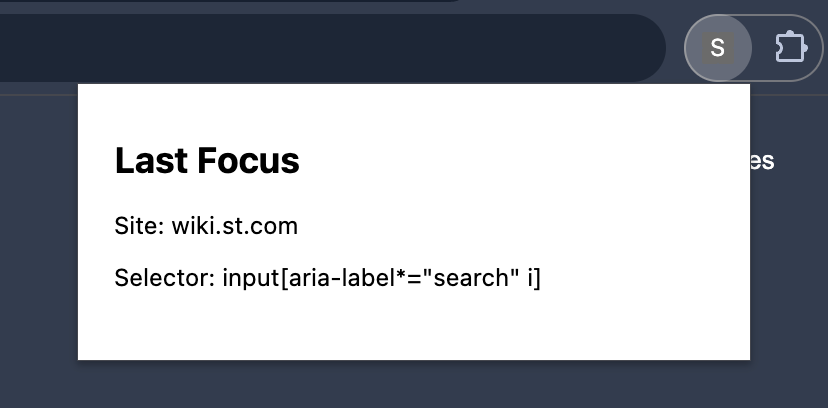

# Search Bar?
Focus the search bar of the active tab by pressing '?' ('/')

## Popup

## Selectors
| Selector                          | Goal |
| --- | --- |
|`input[type="search" i]`           | The standard type for search fields   |
|`input[placeholder*="search" i]`   | Placeholder text                      |
|`input[aria-label*="search" i]`    | Aria label                            |
|`[role="searchbox"]`               | Aria role                             |
|`input[name="q" i], input[name="query" i], input[name="search" i], input[name="s" i], input[name*="keyword" i]` | Name |
|`input[id*="search" i]`            | ID                                    |
|`input[class*="search" i]`         | Class                                 |
